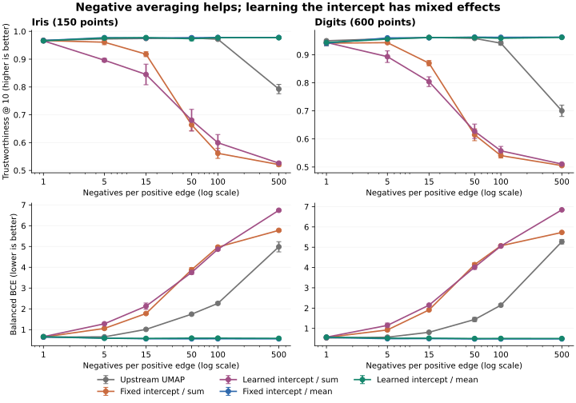

# Learnable kernel intercept and negative reduction: ablation

180 fits: 2 datasets × 3 seeds × 6 negative counts × 5 variants. This is an exploratory comparison, not evidence of universal improvement.

## Findings

- Within the common BCE optimizer, mean reduction consistently beats sum reduction on mean trustworthiness for all tested K > 1 in both datasets, with either fixed or learned intercepts. At K = 1, the paired sum/mean results are identical.
- Learning the intercept does not consistently improve neighborhood quality over the fixed-intercept mean objective. At K = 5 it slightly lowers mean trustworthiness on both datasets; its balanced BCE is slightly lower on Iris and higher on Digits.
- The strongest result here is for negative normalization, not extra representational capacity from the intercept. The intercept and global coordinate scale are redundant away from the numerical floor.
- Upstream is an external reference: it also differs in optimizer, clipping, repulsive stabilization and treatment of negative endpoints. Only the four BCE variants isolate the requested switches.

## K = 5: mean ± sample standard deviation across three seeds

| Dataset | Variant | Trustworthiness ↑ | Balanced BCE ↓ | Silhouette ↑ | Learned bias |
|---|---|---:|---:|---:|---:|
| iris | Upstream UMAP | 0.9728 ± 0.0015 | 0.6525 ± 0.0223 | 0.4171 ± 0.1371 | 0.0000 ± 0.0000 |
| iris | Fixed intercept / sum | 0.9610 ± 0.0090 | 1.0581 ± 0.0651 | 0.2401 ± 0.0815 | 0.0000 ± 0.0000 |
| iris | Learned intercept / sum | 0.8963 ± 0.0065 | 1.2813 ± 0.0305 | 0.1198 ± 0.0643 | -1.9460 ± 0.0277 |
| iris | Fixed intercept / mean | 0.9773 ± 0.0010 | 0.5913 ± 0.0305 | 0.3469 ± 0.1245 | 0.0000 ± 0.0000 |
| iris | Learned intercept / mean | 0.9759 ± 0.0024 | 0.5873 ± 0.0359 | 0.3534 ± 0.1521 | -2.1960 ± 0.1166 |
| digits600 | Upstream UMAP | 0.9570 ± 0.0016 | 0.5670 ± 0.0068 | 0.5048 ± 0.0340 | 0.0000 ± 0.0000 |
| digits600 | Fixed intercept / sum | 0.9429 ± 0.0022 | 0.9246 ± 0.0692 | 0.2917 ± 0.0859 | 0.0000 ± 0.0000 |
| digits600 | Learned intercept / sum | 0.8931 ± 0.0206 | 1.1486 ± 0.1153 | 0.0227 ± 0.0731 | -1.8851 ± 0.0996 |
| digits600 | Fixed intercept / mean | 0.9599 ± 0.0012 | 0.4929 ± 0.0117 | 0.4617 ± 0.0277 | 0.0000 ± 0.0000 |
| digits600 | Learned intercept / mean | 0.9555 ± 0.0039 | 0.5156 ± 0.0124 | 0.3938 ± 0.0450 | -2.1183 ± 0.0284 |

## K = 500: mean ± sample standard deviation across three seeds

| Dataset | Variant | Trustworthiness ↑ | Balanced BCE ↓ | Silhouette ↑ | Learned bias |
|---|---|---:|---:|---:|---:|
| iris | Upstream UMAP | 0.7926 ± 0.0168 | 4.9839 ± 0.2460 | 0.0092 ± 0.0477 | 0.0000 ± 0.0000 |
| iris | Fixed intercept / sum | 0.5209 ± 0.0062 | 5.7757 ± 0.0442 | -0.0353 ± 0.0038 | 0.0000 ± 0.0000 |
| iris | Learned intercept / sum | 0.5261 ± 0.0035 | 6.7411 ± 0.0342 | -0.0335 ± 0.0041 | 1.5200 ± 0.0206 |
| iris | Fixed intercept / mean | 0.9779 ± 0.0014 | 0.5570 ± 0.0160 | 0.4114 ± 0.1304 | 0.0000 ± 0.0000 |
| iris | Learned intercept / mean | 0.9772 ± 0.0006 | 0.5814 ± 0.0244 | 0.3318 ± 0.1386 | -1.7792 ± 0.1200 |
| digits600 | Upstream UMAP | 0.7002 ± 0.0204 | 5.2709 ± 0.1115 | -0.1146 ± 0.0138 | 0.0000 ± 0.0000 |
| digits600 | Fixed intercept / sum | 0.5051 ± 0.0026 | 5.7290 ± 0.0253 | -0.0926 ± 0.0152 | 0.0000 ± 0.0000 |
| digits600 | Learned intercept / sum | 0.5106 ± 0.0024 | 6.8418 ± 0.0134 | -0.0947 ± 0.0105 | 1.6366 ± 0.0026 |
| digits600 | Fixed intercept / mean | 0.9626 ± 0.0010 | 0.4822 ± 0.0102 | 0.4496 ± 0.0091 | 0.0000 ± 0.0000 |
| digits600 | Learned intercept / mean | 0.9616 ± 0.0007 | 0.5026 ± 0.0209 | 0.4472 ± 0.0358 | -1.6980 ± 0.0335 |

## Trustworthiness versus the number of negatives

| Dataset | Variant | K = 1 | K = 5 | K = 15 | K = 50 | K = 100 | K = 500 |
|---|---|---:|---:|---:|---:|---:|---:|
| iris | Upstream UMAP | 0.9678 | 0.9728 | 0.9744 | 0.9763 | 0.9717 | 0.7926 |
| iris | Fixed intercept / sum | 0.9670 | 0.9610 | 0.9179 | 0.6638 | 0.5614 | 0.5209 |
| iris | Learned intercept / sum | 0.9659 | 0.8963 | 0.8451 | 0.6804 | 0.5994 | 0.5261 |
| iris | Fixed intercept / mean | 0.9670 | 0.9773 | 0.9764 | 0.9771 | 0.9782 | 0.9779 |
| iris | Learned intercept / mean | 0.9659 | 0.9759 | 0.9775 | 0.9735 | 0.9772 | 0.9772 |
| digits600 | Upstream UMAP | 0.9497 | 0.9570 | 0.9615 | 0.9582 | 0.9411 | 0.7002 |
| digits600 | Fixed intercept / sum | 0.9411 | 0.9429 | 0.8698 | 0.6148 | 0.5406 | 0.5051 |
| digits600 | Learned intercept / sum | 0.9436 | 0.8931 | 0.8040 | 0.6273 | 0.5577 | 0.5106 |
| digits600 | Fixed intercept / mean | 0.9411 | 0.9599 | 0.9604 | 0.9627 | 0.9619 | 0.9626 |
| digits600 | Learned intercept / mean | 0.9436 | 0.9555 | 0.9613 | 0.9612 | 0.9586 | 0.9616 |

## Protocol

- Upstream base: `lmcinnes/umap@8c925ee2b2a0b8425d4a240dfbfb91eadec43c93` (2026-11-11).
- Iris: all 150 rows. Digits: 600 rows sampled without replacement with seed 2026. Features standardized before fitting; labels are used only to calculate silhouette.
- Seeds: 0, 1, 2. Negative counts: 1, 5, 15, 50, 100, 500. Epochs: 200. Other common settings: n_neighbors=15, min_dist=0.1, repulsion_strength=1, learning_rate=1, n_jobs=1, compatibility_layout=True.
- For each dataset/seed all variants receive the same Gaussian initialization, passed through the same compatibility rescaling. Graph construction and edge schedules use the same settings. The four BCE variants use the same negative draws for a given seed and K.
- Bias initialization: 0. Bias Adam learning rate: 0.1. Standard Adam moments (0.9, 0.999), epsilon 1e-8, linearly decayed learning rates. No hyperparameter search was performed.
- Balanced BCE is evaluated on the full training fuzzy graph, weighted by its edge weights, plus 50,000 independent uniform non-self negatives (seed 1729; source drawn from the weighted graph marginal). It is not held-out positive-edge performance. The training schedule approximates graph weighting and prunes sufficiently small edges.
- Trustworthiness uses 10 neighbors in the standardized input space. Silhouette uses the class labels. The CSV also records RMS radius, fitted intercept and wall time; timings include first-call JIT compilation and are not a rigorous speed benchmark.
- Negatives are sampled with replacement, so K can exceed the number of distinct endpoints. The high-K sweep tests a more precise estimate of the same noise expectation, not 500 distinct negatives per edge.
- Raw results: [balanced_bce.csv](balanced_bce.csv). Reproduce from the repository root with `python benchmarks/benchmark_balanced_bce.py`.
- Regenerate the report and figure with `python benchmarks/summarize_balanced_bce.py` (requires pandas and matplotlib from the plot extra).
- The reported sample standard deviations describe only these three seeds, not statistical significance.

## Environment

Python 3.12.14; NumPy 2.3.5; SciPy 1.17.0; scikit-learn 1.8.0; Numba 0.68.1.

## Mathematical reference

Matt Shannon, [Properties of f-divergences and f-GAN training](https://arxiv.org/abs/2009.00757), equation 39. For balanced BCE L (sum of the two class expectations), the canonical JS lower bound is `4 log(2) - 2 L`. See [the objective documentation](../../doc/balanced_bce.rst) for the derivation, fixed-versus-learned intercept distinction, sampling distribution and limitations.
